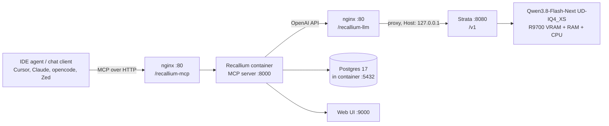

# Recallium on zen3-nixos

[Recallium](https://github.com/recallium-ai/recallium) is a self-hosted memory
server for AI agents: an MCP server + web UI + Postgres that stores what you
and your agents learn, then serves it back through semantic search. This box
runs the `recalliumai/recallium:latest` container and drives its LLM
processing with the **Strata engine** (Qwen3.8-Flash-Next on the R9700, see
`docs/strata.md`) — no cloud APIs involved.

- **UI:** `http://192.168.49.50:9001` or `http://192.168.49.50/recallium/`
- **MCP endpoint:** `http://192.168.49.50/recallium-mcp` (Streamable HTTP, protocol 2025-11-25)
- **REST API:** `http://127.0.0.1:8001/api/...` (direct) or `:8001` from the box

---

## Architecture



- **LLM endpoint** — the container's OpenAI provider (account id 3) has a fixed
  `base_url` of `http://host.containers.internal/recallium-llm`. nginx strips
  the prefix and proxies to **Strata on loopback** (`127.0.0.1:8080/v1/…`) — the
  same upstream `https://strata.ai.chrisdell.info/` serves, reached directly
  instead of hairpinning through TLS and the public IPv6 address. The backend is
  whatever `hosts/zen3-nixos/ai/strata.nix` runs; changing it is a Nix change in
  that one location block (`/recallium-llm/` in `hosts/zen3-nixos/ai/recallium.nix`).
  Two things the proxy has to get right, both learned the hard way:
  - **`proxy_set_header Host 127.0.0.1;`** — Strata's DNS-rebinding guard 403s
    any Host it was not told about (`Host 'host.containers.internal' is not
    allowed`), and `recommendedProxySettings` forwards the client's Host
    verbatim. `127.0.0.1` is allowed by default; `allowed_hosts` in `strata.nix`
    carries only the public names.
  - **`client_max_body_size 32m;`** — a metadata prompt carries the whole
    session and nginx's 1 MiB default would 413 it (Strata's own cap is 32 MiB).
- **Model routing** — Strata serves ONE model and routes by engine, not by the
  requested name: a `/v1/chat/completions` naming any (even unknown) model
  returns the loaded `qwen3.8-flash-next-ud-iq4-xs`. So the `model_name` row in
  Recallium's DB (`Qwen3-4B-Instruct-2507-Q4_K_M`, model id 1006) is **cosmetic
  and stale** — switching the quant Strata serves (`config.ai.strataModel`) is
  all it takes, no DB change. Under llama-swap this used to be the opposite: the
  name had to match a GGUF basename in `/home/cjdell/Models`.
- **Embeddings** — fully offline `nomic-ai/nomic-embed-text-v1.5` (baked into
  the image, embedding config id 1). No external calls ever.
- **Volumes** — `/var/lib/recallium/{data,wal,documents,secrets}` (tmpfiles,
  uid 1000). Container is `autoStart` rootful podman, like `diamcp`.

## Active configuration (as of last change)

| Thing | Value |
| --- | --- |
| LLM provider | openai → `http://host.containers.internal/recallium-llm` (nginx proxy → Strata) |
| LLM model | served by the engine: `qwen3.8-flash-next-ud-iq4-xs`. Recallium's row says `Qwen3-4B-Instruct-2507-Q4_K_M` (config id 1002, model id 1006, openai provider account id 3) — Strata ignores the name |
| LLM GPU | R9700 (32 GB VRAM + RAM + CPU offload) — the model `hosts/zen3-nixos/ai/strata.nix` runs |
| Embedding | `nomic-ai/nomic-embed-text-v1.5` (local, 768-dim, config id 1) |
| Ports | 8001→:8000 MCP · 9001→:9000 UI · 5433→:5432 Postgres |

`GET /api/setup/status` shows `completed: true, active_llm_config_id: 1002`.

Verified end to end 2026-10-15 after the llama-swap → Strata switch: container →
`/recallium-llm` → Strata chat completion, a memory created through
`POST /api/memories/` reached `complete` with a Strata-written summary and
tags, semantic search returned it, and `initialize` on `/mcp` answered.

---

## Connecting clients (MCP)

Point any MCP-capable client at the LAN URL. Everything goes through nginx on
port 80, so no per-machine tunnel is needed:

```json
{
  "mcpServers": {
    "recallium": {
      "url": "http://192.168.49.50/recallium-mcp"
    }
  }
}
```

- **Cursor:** add to project/global `.mcp.json`.
- **Claude Desktop / Claude Code:** add under `mcpServers` in the config.
- **opencode:** add to `opencode.json` MCP servers.
- **Zed:** context server with the same URL (or `http://127.0.0.1:8001/mcp`
  when running on the box itself).

Verify with:

```sh
curl -s -X POST http://192.168.49.50/recallium-mcp \
  -H 'Content-Type: application/json' -H 'Accept: application/json, text/event-stream' \
  -d '{"jsonrpc":"2.0","id":1,"method":"initialize","params":{"protocolVersion":"2025-11-25","capabilities":{},"clientInfo":{"name":"smoke","version":"1"}}}'
```

The 28 MCP tools include: `store_memory`, `search_memories`, `expand_memories`,
`modify_memory`, `get_rules`, `get_insights`, `session_recap`, `create_task`,
`complete_task`, `start_thinking`, `add_thought`, project CRUD, and more.
`tools/list` returns full schemas with guidance on when to use each tool.

---

## REST quick start (verified commands)

### 1. Create a project

```sh
curl -s -X POST http://127.0.0.1:8001/api/projects/ \
  -H 'Content-Type: application/json' \
  -d '{"name":"my-app","description":"My app","settings":{}}'
```

### 2. Store a memory

> ⚠️ `POST /api/memories/` always answers `500 Internal Server Error` — that is
> a known upstream response-schema bug (the response model requires fields like
> `uuid` that the row doesn't carry). **The row is still created and processed.**
> Ignore the 500 and read the memory back by id.

```sh
curl -s -X POST http://127.0.0.1:8001/api/memories/ \
  -H 'Content-Type: application/json' \
  -d '{"project_id":103,"content":"We moved auth to OAuth2 with refresh tokens. Access tokens live 15m, refresh 30d, stored httpOnly.","memory_type":"decision"}'
# -> {"error":"Internal server error"}   (expected — ignore)

curl -s "http://127.0.0.1:8001/api/memories/?limit=1&order_by=id&order_direction=DESC&project_name=my-app"
```

### 3. Watch it process

```sh
curl -s http://127.0.0.1:8001/api/memories/<id>
```

`processing_status` goes `pending → processing → complete` in ~27 s (measured
2026-10-15: `total` 26.6 s — `llm_enrichment` 25.1 s, everything else < 0.2 s).
The engine is always resident, so there is no cold-start penalty; the queue in
front of it is the only thing that varies. On completion the row has a
markdown `summary` (bold `**Type: Topic**` header) and `smart_tags`.

### 4. Search

```sh
curl -s "http://127.0.0.1:8001/api/memories/search?query=oauth+refresh+token&project_name=my-app&limit=5"
```

Hybrid semantic/keyword search; each hit carries a `similarity` score.

---

## MCP usage demo (what agents actually do)

```sh
# initialize (any JSON-RPC session starts here)
curl -s -X POST http://127.0.0.1:8001/mcp \
  -H 'Content-Type: application/json' -H 'Accept: application/json, text/event-stream' \
  -d '{"jsonrpc":"2.0","id":1,"method":"initialize","params":{"protocolVersion":"2025-11-25","capabilities":{},"clientInfo":{"name":"demo","version":"1"}}}'

# store a memory
curl -s -X POST http://127.0.0.1:8001/mcp \
  -H 'Content-Type: application/json' -H 'Accept: application/json, text/event-stream' \
  -d '{"jsonrpc":"2.0","id":2,"method":"tools/call","params":{"name":"store_memory","arguments":{"content":"The deploy script is scripts/deploy.sh; run it from the repo root, it requires $DEPLOY_KEY.","project_name":"my-app","memory_type":"learning"}}}'

# search what we know before starting work
curl -s -X POST http://127.0.0.1:8001/mcp \
  -H 'Content-Type: application/json' -H 'Accept: application/json, text/event-stream' \
  -d '{"jsonrpc":"2.0","id":3,"method":"tools/call","params":{"name":"search_memories","arguments":{"query":"how do we deploy?","project_name":"my-app","limit":3}}}'
```

`search_memories` returns a formatted report (summary, tags, relevance with
vector/keyword/tag breakdown) and often suggests `expand_memories` for context.

### Typical agent workflow

1. **On session start:** `get_rules` (project `__global__` holds universal
   guardrails) and `session_recap` ("where did we leave off?").
2. **Before acting on a topic:** `search_memories` to reuse prior decisions.
3. **On finishing a unit of work:** `store_memory` with type
   `feature`/`decision`/`debug`/`learning` — Recallium auto-summarises, tags,
   and embeds it.
4. **Periodically:** `get_insights` (analysis_type `patterns`, `quality`,
   `technical_debt`, …) to surface recurring issues across projects.

---

## Live demo project

`recallium-demo` (project id 103) contains three processed example memories
(ids 1010–1012) — all real facts from this box's setup, stored via the same
APIs above:

| id | type | summary header |
| --- | --- | --- |
| 1010 | decision | **Decision: LLM Serving Architecture on Zen3-NixOS** (llama-swap + OpenAI-compatible endpoint + GGUF basename auto-load) |
| 1011 | debug | **Debug: GGUF Model Loading Failure** (neutrino-8b-fv5 invalid ggml type 44; use Q4_K_M) |
| 1012 | learning | **Learning: LFM2.5-2.6B-Q8_0 PGLoop Issue** (loops on JSON metadata; Qwen3-Coder works) |

Try it in the UI at `http://192.168.49.50/recallium/` (login, open
`recallium-demo`) or:

```sh
curl -s "http://127.0.0.1:8001/api/memories/search?query=model+that+emits+JSON&project_name=recallium-demo&limit=3"
```

---

## Admin / operations

### Switching the LLM backend (Nix, no DB changes)

The container's OpenAI `base_url` (provider account id 3) is fixed at
`http://host.containers.internal/recallium-llm`, so the backend is chosen by the
`/recallium-llm/` location in `hosts/zen3-nixos/ai/recallium.nix`. It currently
proxies to Strata:

```nix
"/recallium-llm/" = {
  proxyPass = "http://127.0.0.1:8080";          # Strata (./strata.nix)
  extraConfig = '' rewrite ^/recallium-llm/?(.*)$ /v1/$1 break; … '';
```

To go back to llama-swap, re-enable `./llama-swap.nix` in
`hosts/zen3-nixos/ai/default.nix` and restore the old target — `proxyPass =
"http://127.0.0.1:8081"` with `rewrite … /upstream/${config.ai.recalliumGpu}/v1/$1`
(the `recalliumGpu` option still defaults to `r9700` and is only read by
llama-swap now). Then:

```sh
sudo nixos-rebuild switch --flake .   # zen3-nixos: autoRollback is commented out, no nixos-confirm
```

No DB edits and no container restart needed — the proxy is the whole switch, and
Strata ignores the model name (see *Model routing* above). What *does* have to
survive a switch: the two proxy settings the backend needs (`Host`,
`client_max_body_size`) — dropping the `Host` override 403s every Recallium call
with Strata's rebinding message.

To sanity-test the path end to end, ask through the proxy the way the container
does (from inside it, so the `Host` header and the rebinding guard are covered
too):

```sh
cat > /tmp/mr.json <<'EOF'
{"model":"anything","messages":[{"role":"user","content":"Reply with exactly: OK"}],"max_tokens":300}
EOF
sudo podman cp /tmp/mr.json recallium:/tmp/mr.json
sudo podman exec recallium curl -s --max-time 90 http://host.containers.internal/recallium-llm/chat/completions \
  -H 'Content-Type: application/json' -d @/tmp/mr.json
# 403 "Host 'host.containers.internal' is not allowed" => the Host override is gone
```

### Changing the LLM model (only needed if llama-swap comes back)

With Strata this is a no-op: the engine routes by model, not by name, so
`llm_models.model_name` is never matched against anything. The procedure below is
for a name-routed backend (llama-swap / a real API), where the name does matter.

There is **no API for this** (`PUT /api/providers/llm/{id}` only edits
provider *accounts*). Edit Postgres directly (container has psql):

```sh
sudo podman exec recallium psql -h 127.0.0.1 -U recallium -d recallium_memories
# (password: recallium_password) — `-h` is required: there is no unix socket at
# /var/run/postgresql, Postgres listens on TCP only.
```

```sql
-- 1. Register the new model (must match a GGUF basename in /home/cjdell/Models)
INSERT INTO llm_models (provider_name, model_name, input_cost_per_1k, output_cost_per_1k,
                        supports_streaming, supports_function_calling, supports_json_mode,
                        max_context_tokens, max_output_tokens, daily_free_limit, is_free_tier,
                        provider_account_id)
VALUES ('openai', 'NEW-BASENAME', 0, 0, true, true, false, 128000, 4096, NULL, false, 3)
RETURNING id;

-- 2. Point the active config (id 1002) at it, and deactivate the old one
UPDATE llm_provider_configs SET is_active = false WHERE is_active = true;
UPDATE llm_provider_configs SET model_id = <new_id>, health_status = NULL,
       health_error = NULL, is_active = true
WHERE id = 1002;

-- 3. IMPORTANT: active_llm_config_id is NOT read from is_active — it is the
--    first ACTIVE row of llm_failover_priority ordered by priority_order.
--    Repoint that row at the config you activated above:
UPDATE llm_failover_priority SET llm_config_id = 1002 WHERE llm_config_id = 1004;
```

Then restart so the provider cache picks it up (data lives in volumes, safe):

```sh
sudo podman restart recallium
```

Sanity-test a candidate model before switching it into Recallium (the metadata
prompt lives at `/tmp/recallium_prompt.txt` if you need it) — through the
proxy, not the legacy ollama bridge:

```sh
curl -s --max-time 300 -X POST http://127.0.0.1/recallium-llm/chat/completions \
  -H 'Content-Type: application/json' \
  -d '{"model":"<BASENAME>","messages":[{"role":"system","content":"<full metadata prompt>"},{"role":"user","content":"CONTENT: test\n\nPROJECT: test\nTYPE: learning"}],"stream":false,"max_tokens":700,"temperature":0.1}'
```

### Restarting / logs

```sh
sudo podman restart recallium
sudo podman logs --tail 100 recallium
```

### DB access

```sh
PGPASSWORD=recallium_password psql -h 127.0.0.1 -p 5433 -U recallium -d recallium_memories
# or from inside: sudo podman exec -it recallium psql -h localhost -U recallium -d recallium_memories
```

---

## Known quirks & troubleshooting

- **MCP server can wedge (upstream bug).** The app's MCP endpoint intermittently
  stops responding to `/mcp` (clients see "context server request timeout"; the
  container may need `SIGKILL` to stop). A systemd watchdog
  (`recallium-healthcheck.timer`, every 2 min) POSTs an `initialize` and
  restarts the container if two consecutive checks fail — it self-heals, but a
  client connected during the wedge must reconnect. The probe deliberately
  **exits 0 always** and skips containers younger than 180 s: the timer's
  `OnBootSec` has long passed, so it fires the moment it is installed — during
  `switch-to-configuration`, next to `podman-recallium` itself — and a curl exit
  7 (nothing listening yet) under `set -e` used to fail the unit, which makes
  the whole activation report `status 4` even though everything was applied.
- **Recallium shares Strata's ONE slot with everything else.** Strata runs
  `concurrency.serving: 1`, so a memory-enrichment call queues behind an
  interactive request (and vice versa) — hence `proxy_read_timeout 3600s` on
  `/recallium-llm/`, not the 600 s it had with llama-swap. Measured cost of one
  memory: ~27 s total, of which `llm_enrichment` 25.1 s (`metadata.processing_time_ms`
  on the row). `MEMORY_PROCESSOR_MAX_WORKERS = 8` in the container is therefore
  about embedding/tag parallelism, not LLM concurrency — it cannot speed the LLM
  up, it only fills the queue.
- **CORS for the MCP endpoint is handled at nginx**, not by the app: the
  container's `CORSMiddleware` only permits its fixed `CORS_ORIGINS` list and
  returns 400 to preflights from any other origin. The `/recallium-mcp` nginx
  location answers `OPTIONS` locally and stamps `Access-Control-Allow-Origin`
  (echoing the request origin) on every response, so browser-based MCP clients
  on any origin work. The app-level `CORS_ORIGINS` env only matters when
  hitting `:8001` directly.
- **`POST /api/memories/` returns 500** even on success (missing `uuid`/
  `embedding_model`/`embedding_dimensions` in the response model). The row is
  created; read it back via `GET /api/memories/{id}`.
- **The metadata prompt contains literal `{{` / `}}`** (Recallium's template
  escaping). Well-behaved models copy the doubled braces — Recallium's parser
  tolerates it, so don't "fix" the output.
- **`mcp_tools_enabled: false`** in `/api/setup/status` is cosmetic — the MCP
  server works and all 28 tools are registered.
- **Model must emit JSON reliably.** Tiny models loop forever on the metadata
  prompt: `LFM2.5-2.6B-Q8_0` PGLoops (`PG PG PG…`), ignores token caps, and
  burns CPU for hours. `Qwen3-Coder-REAP-25B-A3B-Rust-Q4_K_M` reliably emitted
  valid metadata in ~25 s; Qwen3.8-Flash-Next does too (verified 2026-10-15:
  summary + 15 smart_tags, `processing_status: complete`). It is a *thinking*
  model, so the chain of thought arrives in `reasoning_content` and `content`
  holds the clean JSON — that split is what keeps Recallium's parser happy, and
  `response_format: {"type":"json_object"}` is honoured (Strata implements it as
  prompt-and-validate, `constrained_decoding: false`, so a malformed object is
  still possible in principle).
- **Client timeout → zombie generation.** Recallium's client times out at 120 s
  but the engine keeps generating after the disconnect, and with one slot that
  orphan blocks every other request. llama-swap's unload endpoints
  (`POST :8081/api/models/unload`) are gone with it; Strata has
  `POST /v1/unload` but it answers `409 a request is running or queued` rather
  than interrupting the in-flight generation — there is no cancel. So a runaway
  generation can only be stopped by restarting the engine, which costs a full
  model reload (tens of GB, minutes):
  ```sh
  curl -s --max-time 30 -X POST http://127.0.0.1:8080/v1/unload   # idle only
  sudo systemctl restart strata                                   # last resort
  ```
- **GGUF compatibility** *(llama-swap era; Strata loads its own pack)*. Some
  models in `/home/cjdell/Models` use quant formats that llama.cpp build can't
  read (`neutrino-8b-fv5.gguf` → `invalid ggml type 44`). Stick to
  Q4_K_M/Q8_0 era quantisations, or check
  with `llama-cli -m <file> --no-warmup -p x -n 1` before wiring one in.
- **Health checks** go through the same proxy: `curl -s -X POST
  http://127.0.0.1:8001/api/providers/health-check -H 'Content-Type:
  application/json' -d '{"provider_account_id":3}'` reports per-provider
  status (the *ollama account* row itself stays `inactive` in that response —
  only the config's `health_status` matters, which sits in
  `llm_provider_configs`).
